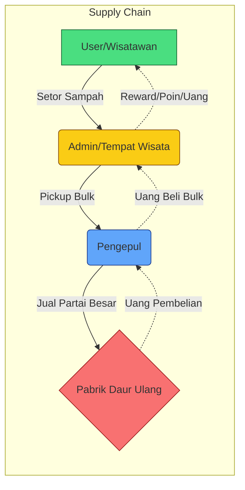

# ReLoop: Panduan Alur Bisnis & Peran (Business Logic & Roles)

Dokumen ini menjelaskan bagaimana ekosistem **ReLoop (Smart Waste Bank)** bekerja di dunia nyata, model bisnis yang digunakan (khususnya untuk studi kasus pariwisata), serta peran masing-masing aktor dalam sistem. Dokumen ini ditujukan bagi *Developer*, *Agent*, dan *Stakeholder* agar memiliki pemahaman yang selaras mengenai *Supply Chain* pengelolaan sampah.

---

## 1. Aktor & Peran (Roles)

Di dalam sistem ReLoop, terdapat 4 peran (Role) utama yang saling berkesinambungan:

1.  **User (Wisatawan / Tour Guide / Masyarakat Umum)**
    *   **Peran:** Aktor yang menyetorkan sampah.
    *   **Insentif:** Mendapatkan *Reward/Poin* yang bisa dicairkan menjadi uang (e-Wallet) atau *voucher* (diskon tiket wisata, suvenir, dll).
2.  **Admin (Pengelola Tempat Wisata / Bank Sampah Unit)**
    *   **Peran:** *Agregator Pertama*. Mereka yang menyediakan lokasi (gudang/mesin IoT), memberikan poin kepada User, dan mengumpulkan sampah dari banyak User menjadi tumpukan besar (Bulk).
    *   **Insentif:** Mendapatkan keuntungan (margin) dari menjual sampah dalam skala besar ke Pengepul, dengan harga yang lebih tinggi daripada nilai poin yang mereka berikan ke User. Selain itu, kawasan mereka menjadi bersih secara gratis.
3.  **Pengepul (Mitra Kolektor / Daur Ulang)**
    *   **Peran:** *Off-taker*. Aktor logistik yang mengambil/membeli sampah *bulk* dari lokasi Admin ketika gudang Admin sudah penuh (melalui fitur *Pickup Request*). Pengepul **tidak** berinteraksi langsung dengan User eceran.
    *   **Insentif:** Mendapatkan pasokan sampah yang sudah *tersortir dan bersih* (high-quality waste) dalam jumlah besar dari satu titik (hemat biaya operasional truk). Mereka meraup untung dengan menjualnya ke Pabrik Daur Ulang industri dengan harga tinggi.
4.  **Superadmin (Pihak ReLoop / Penyedia Platform)**
    *   **Peran:** Penyedia ekosistem *Software as a Service* (SaaS) dan pembuat *Smart IoT Bin*.
    *   **Insentif:** Pendapatan dari biaya sewa platform/mesin (Subscription), persentase potongan (Transaction Fee) dari pencairan poin, serta monetisasi data analitik / ESG (Environmental, Social, & Governance) ke perusahaan FMCG (Danone, Coca-Cola, dll).

---

## 2. Alur Fisik (Supply Chain)

Secara sederhana, pergerakan sampah dan pergerakan uang bekerja berlawanan arah:

*   **Fisik Sampah:** `User` ➡️ `Admin (Tempat Wisata)` ➡️ `Pengepul` ➡️ `Pabrik Daur Ulang`
*   **Perputaran Uang:** `Pabrik Daur Ulang` ➡️ `Pengepul` ➡️ `Admin (Tempat Wisata)` ➡️ `User`

---

## 3. Fitur Utama & Alur Penggunaan (Use Cases)

Sistem ReLoop dirancang fleksibel untuk dua skenario utama di lapangan:

### Skenario A: Deposit Individu (Smart Machine / Mesin Pintar)
Ditujukan untuk **Wisatawan Individu** yang sedang berjalan-jalan di kawasan wisata.
1.  Wisatawan melihat Mesin Pintar ReLoop.
2.  Wisatawan mengunduh aplikasi ReLoop, membuka fitur **Scan**, lalu memindai QR Code di layar mesin.
3.  Pintu mesin terbuka, wisatawan memasukkan botol plastik satu per satu.
4.  Sensor IoT (Kamera AI & Timbangan) mendeteksi jenis dan berat botol.
5.  Poin langsung di-kreditkan (ditransfer) ke akun e-Wallet (Dompet ReLoop) milik wisatawan tersebut.
6.  Wisatawan dapat mencairkan (*redeem*) poin tersebut lewat menu **Wallet / Pencairan**.

### Skenario B: Deposit Kolektif / Rombongan (Trip & Trash Bag QR)
Ditujukan untuk **Rombongan Bus Pariwisata** (misal rombongan study tour atau wisata kantor) yang dikoordinasikan oleh seorang *Tour Guide*.
1.  **Registrasi Trip:** Rombongan tiba. Admin tempat wisata mendaftarkan rombongan tersebut ke dalam sistem lewat Web Dashboard, membuat satu entitas **Trip**. Sesi Trip ini ditautkan ke *email akun milik si Tour Guide*.
2.  **Assignment Kantong:** Admin mengambil kantong-kantong sampah kosong yang sudah ditempel stiker **QR Code**, lalu men-scan QR tersebut untuk menautkannya ke sesi Trip tadi. Kantong diserahkan ke rombongan.
3.  **Pengumpulan (Aktivitas Wisata):** Selama rombongan berkeliling lokasi wisata, mereka membuang sampah ke dalam kantong-kantong QR yang mereka bawa.
    *   *Tour Guide dapat membuka aplikasi mobile (fitur Trash Bag) untuk memantau: "Rombongan saya sedang membawa 5 kantong QR."*
4.  **Pengembalian (Drop-off):** Sebelum pulang, rombongan menyerahkan kembali kantong-kantong yang sudah terisi ke pos Admin.
5.  **Validasi & Reward:** Admin men-scan QR code di kantong tersebut. Sistem otomatis tahu bahwa kantong ini milik Trip A (yang dipimpin Tour Guide A). Admin menimbang berat total sampah, menyimpannya di gudang, lalu menyetujui validasinya.
6.  **Pencairan (Redeem):** Poin hasil timbangan langsung masuk ke akun si Tour Guide. Tour Guide bisa menggunakan poin ini untuk membeli suvenir, atau menjadikannya komisi pribadi. (Wisatawan mendapat keuntungan intrinsik berwisata secara ramah lingkungan).

### Skenario C: Penjemputan Sampah Massal (Pickup, dispatch oleh Admin)
Melanjutkan dari Skenario A & B, sampah yang terkumpul akhirnya menumpuk di tempat wisata.
Pickup memakai model **dispatch admin**: setiap tugas dimiliki tepat satu Pengepul yang ditugaskan Admin. Pengepul **tidak** mengambil (self-assign/klaim) tugas sendiri.
1.  Saat gudang atau Mesin Pintar sudah penuh, sistem membuat permintaan pickup (status **Diminta**) dan memberi notifikasi kepada Admin organisasi, atau Admin menekan tombol **Buat Pickup**.
2.  **Admin** (atau Superadmin) menugaskan satu **Pengepul** yang kemitraannya **ACTIVE** dengan organisasi tersebut, dan boleh menentukan **tenggat mulai**. Tidak ada tenggat bawaan; tenggat dipilih Admin saat dispatch. Notifikasi tugas hanya dikirim ke Pengepul yang ditugaskan.
3.  Pengepul yang ditugaskan menyalakan status **"Dalam Perjalanan"**, lalu **Tiba**, **Ambil** (mencatat muatan) dan **Selesai**. Hanya pengepul yang sedang ditugaskan, dengan kemitraan yang masih aktif, yang dapat menjalankan langkah ini.
4.  Admin hanya dapat **mengganti** Pengepul sebelum pekerjaan lapangan dimulai (status Diminta/Ditugaskan). Pengepul lama diberi tahu dan langkahnya ditolak sejak itu. Setelah Pengepul berangkat, penggantian dilakukan dengan **Batalkan** (Admin, sebelum material dimuat) atau **Gagal** (Pengepul). Keduanya **wajib disertai alasan** yang dicatat di audit, lalu Admin membuat **tugas pengganti** yang tertaut ke tugas lama (satu pengganti per tugas).
5.  Jika tenggat mulai terlewati tanpa keberangkatan, tugas ditandai **terlambat** dan Admin aktif organisasi itu menerima satu peringatan per versi penugasan. Sistem tidak pernah menugaskan ulang otomatis; Admin yang memutuskan.
6.  Setiap keputusan membawa versi tugas yang dilihat operator (`expectedVersion`). Keputusan dari tampilan lama ditolak dengan pesan "Tugas telah diperbarui; muat ulang" (detail kontrak: `docs/mobile-api.md`, bagian "Pickup dispatch (B05)").
7.  Pengepul membayar Admin wisata atas sampah curah tersebut.

---

## 4. Kesimpulan untuk Developer
Memahami alur di atas **Sangat Penting** agar developer tidak salah mendesain UI/UX atau API. 
*   **Contoh Fatal Flaw yang harus dihindari:** Membuat fitur agar *User biasa bisa memfoto sampah dan memanggil Pengepul ke rumahnya*. Ini salah kaprah karena *Business Model* ReLoop untuk Pengepul adalah **Bulk Collection** (skala besar dari mitra Admin/Wisata), bukan penjemputan eceran layaknya ojek online.
*   Oleh karena itu, halaman Trash Bag di Mobile User kini bersifat **Read-Only / Tracker** (Skenario B), tempat User/Tour Guide hanya melihat kantong QR apa saja yang menjadi tanggung jawabnya. Input data hanya dilakukan oleh Admin atau Mesin IoT.
