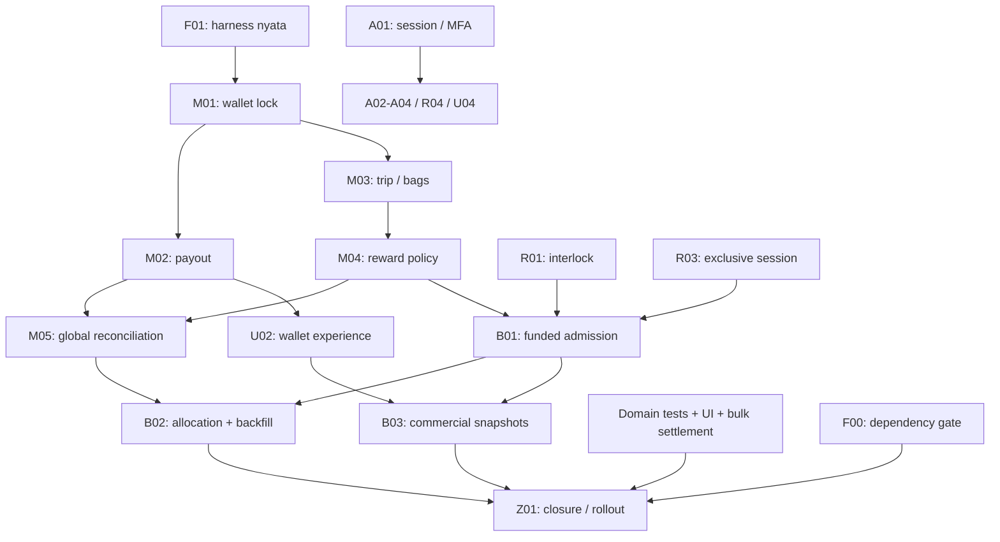

# ReLoop Complete Audit Remediation Implementation Plan

> **For agentic workers:** REQUIRED SUB-SKILL: Use superpowers:subagent-driven-development (recommended) or superpowers:executing-plans to implement this plan task-by-task. Steps use checkbox (`- [ ]`) syntax for tracking.

**Goal:** Menutup seluruh 30 temuan utama dan 4 temuan tambahan audit ReLoop melalui perubahan teruji pada security, wallet/reward, RVM, UI/mobile dan alur bisnis.

**Architecture:** Pertahankan modular monolith dan client yang ada. Ekstrak service transaksi pada batas domain yang perlu atomicity, enforce invariant di PostgreSQL, lalu migrasikan data dan client bertahap. Prioritaskan hotfix autentikasi, keselamatan mesin dan double-spend tanpa menunggu fitur bisnis baru.

**Tech Stack:** Next.js 16 / React 19 / TypeScript, Prisma Client 6 / PostgreSQL16, Redis, Flutter/Dart, Python3 RVM, Vitest, Playwright untuk regresi browser baru.

**Spec:** [Desain remediasi](../specs/2026-10-13-reloop-remediation-design.md), diturunkan dari [audit JSON](../../../artifacts/reloop-audit-2026-10-13.json). Baseline commit `cdd31a5`. Seluruh task masih PLANNED; pembuatan dokumen ini tidak menjalankan implementasi, migrasi, deploy atau transfer uang.

## Global Constraints

- Seluruh nilai uang disimpan sebagai integer rupiah; API menolak pecahan, negatif yang tidak sah, overflow dan nilai di luar batas database.
- Ledger pengguna tetap menjadi sumber saldo; tidak menambahkan kolom saldo kedua tanpa mekanisme konsistensi yang dibuktikan.
- Gunakan Prisma Client 6 API `$transaction` / `$queryRaw` yang tersedia di generated client; jangan menyalin API Prisma 8 `db.transaction` ke repository ini.
- Operasi jaringan, email, push dan transfer pembayaran tidak dijalankan di dalam transaksi database.
- Semua mutasi saldo menggunakan lock user yang sama dan TransactionClient yang sama untuk baca serta tulis.
- Lock order: User -> RewardFundingAccount -> Campaign -> Machine -> Trip -> DepositSession -> DepositItem -> Redemption -> RewardLedger; jika beberapa ID satu kelas, urutkan leksikografis. Transaksi boleh memakai subset berurutan, tetapi tidak boleh memperoleh lock kelas sebelumnya setelah kelas berikutnya.
- Untuk mengetahui ID lock, baca relasi immutable terlebih dahulu; setelah lock diperoleh, baca ulang status, ownership dan angka yang menentukan keputusan.
- Setiap efek finansial baru memiliki business key unik; retry request identik tidak menghasilkan uang atau side effect kedua.
- API lama tetap didukung melalui field tambahan selama migrasi client; field keamanan yang tidak aman tidak diberi fallback permisif.
- Migrasi memakai expand -> backfill/reconcile -> enforce -> contract. Jangan menulis ulang histori finansial atau checksum audit lama untuk membuat laporan terlihat cocok.
- Seluruh pesan pengguna menggunakan bahasa Indonesia dan tidak memuat simulator, acceptance point, token atau detail protokol internal.
- Data cache private mobile dipisahkan per verified user ID, dan response akun lama tidak boleh ditulis setelah logout/pergantian akun.
- Perubahan perilaku mesin tidak dirilis sebelum mock safety tests dan uji hardware terkendali lulus.
- Tidak melakukan deploy, migrasi production, pengiriman undangan, penghapusan akun atau transfer nyata hanya karena dokumen rencana dibuat.

## Review Focus

Lima failure mode ini wajib memiliki pengujian, termasuk setelah jalur normal sudah lulus:
1. Response hilang setelah commit: retry tidak membuat uang/event/payment kedua — M01, M02, R02, U02.
2. Identitas berubah di tengah operasi: logout, email berubah, faktor diganti, role dicabut — A02, A03, R04, U04.
3. Request bersamaan/out-of-order: satu outcome dan snapshot kebijakan yang benar — M01–M04, R03, B01, B05.
4. Data historis tidak konsisten: saldo dan jejak asal tidak ditulis ulang untuk memaksa green — A04, A05, B02, Z01.
5. Koneksi/perangkat terputus: gate aman, outbox tetap durable, user mendapatkan recovery yang benar — R01, R02, U01, U05.

## Struktur dokumen dan kepemilikan

Baca master + spec, kemudian rencana domain sesuai task. Terdapat 27 task reviewable; satu task dapat menjadi beberapa commit kecil dengan satu tujuan PR. Jangan menganggap jumlah task sebagai estimasi hari kerja.

- [01 — Security dan privasi](2026-10-13-reloop-01-security.md): A01–A05. Owner fungsi: backend/security. Token, MFA replacement, invitations, erasure, audit chain.
- [02 — Wallet dan integritas reward](2026-10-13-reloop-02-money.md): M01–M05. Owner fungsi: backend/finance. Lock, idempotency, payout, kantong, reward policy, reconciliation.
- [03 — RVM dan realtime](2026-10-13-reloop-03-machine.md): R01–R04. Owner fungsi: IoT/backend. Interlock, ACK, nonce, sesi tunggal, socket authorization.
- [04 — Web dan mobile](2026-10-13-reloop-04-experience.md): U01–U05. Owner fungsi: frontend/mobile. Scan recovery, wallet, public discovery, account cache, accessibility.
- [05 — Pendanaan dan operasi bulk](2026-10-13-reloop-05-business.md): B01–B05. Owner fungsi: backend/product/operations. Funding, allocation, policy snapshots, settlement, dispatch.
- [06 — Fondasi test dan rollout](2026-10-13-reloop-06-validation-rollout.md): F00, F01, Z01. Owner fungsi: QA/platform dan reviewer domain terkait.
- [Coverage registry](2026-10-13-reloop-remediation-coverage.json): seluruh 34 finding, task pemilik dan status penutupan.

## Urutan pelaksanaan dan release gate

### Gelombang 0 — Fondasi dan hotfix awal

- [ ] A01: session/MFA boundary, termasuk verifier proxy/realtime. Dapat dimulai segera dengan unit regression.
- [ ] R01: safety latch/interlock. Dapat dimulai segera dengan MockHardware.
- [ ] F01: environment test PostgreSQL/Redis/browser/Flutter/Python terisolasi.
- [ ] F00: fresh dependency triage dan patch kompatibel; jangan menjadikan upgrade ORM besar sebagai prasyarat menulis hotfix A01/R01.

Gate: challenge tidak diterima sebagai session; unsafe output tetap mati. Release R01 memerlukan hardware evidence. Release A01 memiliki coordinated logout dan realtime verifier update. Fondasi test tidak mengakses DB operasional.

### Gelombang 1 — Integritas transaksi dan mesin

- [ ] M01 -> M02: reserve dan settlement atomik.
- [ ] M03 -> M04: validasi kantong, aggregate trip, reward mode/AI/rate/review.
- [ ] R02: ACK event dan retry durable.
- [ ] R03: replay TTL dan sesi mesin eksklusif.

Gate: PostgreSQL concurrency tests membuktikan saldo tidak negatif, satu reserve per request, satu reward per business event dan satu sesi per mesin. Duplicate data lama direkonsiliasi sebelum constraints enforced. Backend ACK compatible dirilis sebelum worker baru.

### Gelombang 2 — Identitas, privasi dan recovery pengguna

- [ ] A02, A03, A04, A05: faktor MFA, email ownership, erasure, audit v2.
- [ ] R04 dan U04: authorization socket serta cache akun mobile.
- [ ] M05: report kewajiban global bersih.
- [ ] U01, U02, U03: scan recovery, wallet, pencarian mesin.
- [ ] U05 setelah UI stabil: browser accessibility dan manual assistive-technology verification.

Gate: revoked identity kehilangan akses dalam batas yang ditentukan; pergantian akun tidak menampilkan cache lama; erasure konsisten pada FK nyata; error/recovery UI dibuktikan screenshot+interaction tests. LOG-07 belum CLOSED hanya karena global report benar: per-org allocation menunggu B02.

### Gelombang 3 — Pendanaan dan operasi komersial

- [ ] B01 -> B02: model funding, admission reservations, alokasi dan backfill kewajiban lama; enforcement baru aktif setelah backfill dan confirmed funding.
- [ ] B03: snapshot reward/recipient/fee sesuai asumsi bisnis.
- [ ] B04: quote material, agreement kedua pihak dan settlement manual bulk.
- [ ] B05: dispatch admin, stale-assignment protection dan escalation owner.

Gate: cap funding tidak terlampaui, setiap kewajiban dapat ditelusuri, old balances identik, pembayaran bulk tidak otomatis dianggap selesai dari status logistik. Bila asumsi bisnis berubah, revisi B task dan spec sebelum aktivasi, tanpa membatalkan hotfix terdahulu.

### Gelombang 4 — Penutupan dan rollout menyeluruh

- [ ] Z01: rehearsal migration/restore, seluruh regression, hardware acceptance, observasi canary dan checklist 34/34.

Gate: setiap finding VERIFIED dengan evidence aktual, lalu RELEASED dengan versi deployment. Critical/high runtime dependency yang belum ditriage/fixed menghalangi release; exception harus spesifik, terbatas waktu dan memiliki owner.



Diagram adalah ringkasan; daftar dependensi pada setiap task dan coverage JSON adalah sumber lengkap. Task independen boleh dikerjakan bersamaan oleh pelaksana yang dipilih, tetapi perubahan schema/package lock dikelola satu pemilik. Rencana ini tidak otomatis menjalankan subagent atau membuat worktree.

## File dan batas tanggung jawab baru

- `lib/db-locks.ts`: lock row yang typed dan mengikuti urutan global; tanpa logic payout.
- `lib/wallet-service.ts`: request dan transition redemption di satu transaction boundary.
- `lib/reward-policy.ts`: keputusan murni policy/material; tidak membaca DB.
- `lib/reward-credit.ts`: satu jalur penulisan money effect, unique business key dan funding linkage.
- `lib/trip-validation.ts`: ownership kantong, aggregate trip, satu outcome reward.
- `lib/deposit-session-service.ts`: start/resume session eksklusif; RVM tetap pemilik interlock fisik.
- `lib/reward-funding.ts`, `lib/ledger-allocation.ts`: admission funding/campaign cap serta attribution debit ke kredit.
- `lib/invitations.ts`, `lib/erasure-jobs.ts`: verified claim dan durable erasure jobs.
- `lib/bulk-settlement.ts`, `lib/commercial-policy.ts`: quote/approval bulk dan snapshot kebijakan.
- Komponen UI baru hanya untuk dialog, discovery, funding dan settlement. Gunakan tokens existing, bukan design system baru.

## Kontrak harness F01

Type berikut adalah kontrak helper test yang **dibuat oleh F01**, bukan API production. Gunakan helper dari `tests/support/audit-fixture.ts`. Fixture tiap test membersihkan data miliknya dan membuat A/B organizations, USER A/B, ADMIN A/B, SUPERADMIN, dua PENGEPUL, satu payout account milik A, adminA dengan MFA enabled dan secret test terenkripsi untuk test replacement, mesin online dengan tarif/material valid, dan program active MONEY_REWARD. Seluruh alamat memakai `.test` dan transport email/push palsu.

```ts
import type { PrismaClient } from "@prisma/client";
import type { Page } from "@playwright/test";

type ActorKey = "guest"|"userA"|"userB"|"adminA"|"adminB"|"superadmin"|"collectorA"|"collectorB";
type TestIds = {
  userA:string;userB:string;adminA:string;adminB:string;superadmin:string;
  collectorA:string;collectorB:string;orgA:string;orgB:string;
  machineA:string;machineCode:string;payoutAccountA:string;
};
interface AuditFixture {
  db:PrismaClient;
  ids:TestIds;
  json(as:ActorKey,method:string,path:string,body?:unknown):Promise<Response>;
  seedBalance(amount:number):Promise<void>;
  seedCredit(input:{organization:"A"|"B";amount:number}):Promise<void>;
  processingRedemption(amount:number):Promise<string>;
  redeemAndSettle(amount:number):Promise<string>;
  trip(input:{bagCount:number;organization?:"A"|"B";
    recipientConfirmed?:boolean;status?:"PLANNED"|"ACTIVE"}):Promise<{id:string;bagIds:string[]}>;
  pendingInvite(email:string):Promise<{travelAgentId:string;id:string;token:string}>;
  depositHistory():Promise<void>;
  machineQrToken():Promise<string>;
  pickup():Promise<{id:string}>;
  confirmFunding(amount:number):Promise<void>;
  reserveBudget(input:{businessKey:string;amount:number}):Promise<string>;
  gateway():Promise<RealtimeHarness>;
  dispose():Promise<void>;
}
interface RealtimeHarness {
  connect(actor:ActorKey,options?:{ttlSeconds:number}):Promise<{receivedCount():Promise<number>}>;
  advanceClock(ms:number):Promise<void>;
  publish(event:{topic:"security-alert";organizationId:string;machineCode:string;eventType:string}):Promise<void>;
  close():Promise<void>;
}
interface BrowserFixture {
  login(page:Page,actor:ActorKey):Promise<void>;
  startDeposit():Promise<void>;
  requestRedemption():Promise<void>;
  machinesForMap():Promise<void>;
}
```

Implementasi helper harus memenuhi:
- `json` memakai HTTP ke server test nyata dengan cookie hasil `signSession`; guest tanpa cookie. Signature/token version memakai code produksi. Login-specific test tetap lewat /api/auth/login, bukan helper cookie, untuk menguji MFA end-to-end.
- `seedBalance` dan `seedCredit` hanya seed dalam DB test, memakai schema actual dan key fixture unik. `processingRedemption` menambahkan saldo bila fixture awal0, lalu membuat satu request PROCESSING dengan reserve yang cocok. `redeemAndSettle` memakai saldo existing, lalu request/approve/process/success melalui API.
- `trip` default ACTIVE, campaign TRASH_BAG MONEY_REWARD, userA recipient, organization sesuai input, bagCount records unik, user agent gate tidak required. Setelah B03, default recipientConfirmed=true dan contentConfirmed diberikan secara eksplisit pada payload test yang mengharuskan reward. Historical fixture tetap bisa menguji data lama.
- `pendingInvite` tidak membuat membership; secret token hanya tersedia dalam fixture, disimpan hash setelah A03. `depositHistory` membuat session terminal tanpa saldo untuk test FK erasure.
- `confirmFunding` dan `reserveBudget` diimplementasikan saat B01 contract tersedia; F01 menyediakan extension point typed untuk test services, tanpa empty fake-success implementations. Sebelum B01, test suite yang memanggilnya belum diaktifkan; jangan mengekspor stub yang silently pass.
- `gateway` menggunakan child process terisolasi dengan clock injection environment khusus test dan fake internal verification server. Hook clock tidak boleh tersedia di service production; production module menerima clock dependency internal, tidak endpoint manipulasi waktu.
- Vitest beforeEach membuat `export let f:AuditFixture`, afterEach dispose. FileParallelism=false untuk suite real DB; query concurrency di dalam test tetap memakai dua koneksi berbeda. Test isolation juga berlaku audit chain yang bergantung seluruh rows.
- Browser test mengimpor `test,expect` dari `tests/support/browser-fixture.ts` yang extends Playwright fixture. BrowserFixture berbagi underlying DB test, bukan production.
- Python regression baru memakai `tempfile.TemporaryDirectory`, RvmConfig hardware_driver="mock", secret khusus test, SQLite sementara. MockHardware menggunakan `patch(service_panel_open=True)` dan `read()`. Signed lease helper mengikuti HMAC canonical `id.sessionId.issuedAt.expiresAt` existing; tidak memakai credential mesin nyata.

## Migrasi dan kompatibilitas

1. **Auth boundary:** strict new tokens memaksa login ulang; web/realtime/mobile401 behavior dirilis terkoordinasi. Jangan menerima legacy challenge demi kompatibilitas.
2. **Schema additive:** pending MFA/invites/business keys/audit version/funding/settlement/dispatch version ditambahkan nullable atau default aman. Constraint uniqueness baru sesudah preflight duplicate report0 atau kasus historis direkonsiliasi.
3. **Ledger lama:** inventarisasi duplicate rewards, negative balances, mismatched reserves, orphan references dan active-session collisions. `dry-run` menulis report saja. `apply` memerlukan digest run yang ditinjau; tidak memakai delete massal atau `prisma migrate reset` production.
4. **Outbox RVM:** backup SQLite, schema upgrade menjaga event/capture IDs dan attempts. Backend mengerti protocol2 sebelum worker2 rollout. Pending queue tidak dihapus saat rollback.
5. **Mobile:** API additive sebelum app; cache migration menghapus unscoped private cache sekali. Old app yang tidak dapat mematuhi request baru diberi upgrade-required untuk operasi terdampak, bukan dibiarkan mengabaikan kontrol.
6. **Funding:** schema/shadow reporting -> opening obligations + allocations -> confirmed cash -> reconcile gap -> enforce admission cap. Old user balance tidak dipotong untuk menutupi gap dana.
7. **Audit:** legacy checksum immutable; checkpoint version2 memberi batas yang dapat dijelaskan. UI tidak mengklaim legacy valid bila tidak dapat diverifikasi.
8. **Commercial snapshots:** existing amount -> gross=amount, fee0, net=amount; missing historical destination ditandai unknown legacy. Tidak mengarang bukti transfer.
9. **Rollback:** gunakan app versi terakhir yang tetap memenuhi security floor; jika tidak ada, pause fitur terkait dan forward-fix. Migrasi destructive/contract menunggu seluruh client baru dan restore rehearsal.

## Asumsi produk dan titik keputusan

Asumsi desain lengkap di spec. Nilai awal plan: reward partisipasi Rp2.000 per issued+verified bag, admin dispatch, fee pencairan0, manual funding verification dan manual bulk settlement. Ini bukan aktivasi kebijakan komersial baru.

Sebelum B01/B03 aktif, product/operations harus meninjau konfigurasi campaign cap, maksimum reward sesi, batas kantong, recipient consent, SLA operasional serta owner pendanaan. Form aktivasi menolak konfigurasi penting yang kosong. Tidak ada angka margin, target pendapatan atau SLA yang dikarang dari audit.

Subscription otomatis, payment gateway baru, marketplace collector self-claim dan konversi insentif kantong menjadi harga kilogram tidak diperlukan untuk menutup gap dengan asumsi di atas. Dokumen produk harus menyatakan mana kebijakan yang aktif; jika pengguna memilih model-model tersebut, ubah spec dan task bisnis secara eksplisit sebelum implementasi terkait.

## Definition of done

- [ ] Setiap finding utama dan tambahan memiliki task implementasi, regression evidence dan commit yang dapat ditinjau.
- [ ] Auth/MFA/ownership/cache tests mencakup actor lain serta identitas yang berubah di tengah request.
- [ ] PostgreSQL integration tests membuktikan saldo, payout, credit uniqueness, session uniqueness, bag scope, FK erasure dan source allocation.
- [ ] RVM ACK tests membuktikan mixed results, lost responses dan restart; safety terverifikasi pada mock serta perangkat terkendali.
- [ ] UI web/mobile mempunyai success/error/offline/empty/loading recovery dan evidence keyboard/accessibility/responsive.
- [ ] Funding/budget dan bulk settlement dapat direkonsiliasi; saldo legacy sebelum/sesudah sama.
- [ ] Fresh unit/typecheck/lint/build, browser, realtime, Python dan Flutter checks lulus; dependency runtime blockers ditutup.
- [ ] Runbook deploy/restore/rollback, monitoring owner dan alert threshold terisi berdasarkan baseline staging.
- [ ] Coverage registry berstatus VERIFIED sebelum release, RELEASED sesudah deployment aktual; tidak ditandai closed hanya karena dokumen atau mock test selesai.

## Baseline yang sudah diketahui

Audit sebelumnya pada13 Oktober2026: 1.211 test JS/TS dalam131 file lulus, typecheck lulus, lint0 error/4 warning. Python run memiliki24 passed,1 skipped,2 import errors karena cv2 belum tersedia pada interpreter audit. Browser screenshot/hardware production belum diverifikasi. Angka ini adalah baseline historis, bukan hasil eksekusi rencana ini.

## Handoff eksekusi

Mulai dari A01, R01 dan F01; lanjutkan menurut dependensi. Gunakan isolated branch/worktree ketika implementasi dimulai, mengikuti skill using-git-worktrees. Native execution cocok untuk menjaga urutan schema dan transaksi; bila memilih subagent-driven, tugas independen boleh dipisah dengan satu owner integrasi/schema dan review tiap PR. Tidak perlu menentukan metode eksekusi untuk membaca atau menyelesaikan rencana ini.

Dokumen ini selesai bila pemetaan34/34, seluruh path existing valid, interface konsisten, dependensi bebas siklus, dan tidak ada langkah yang menunda isi penting ke placeholder. Pembuatan dokumen tidak menyatakan masalah aplikasi sudah diperbaiki.

## Pemetaan seluruh temuan

- [ ] **SEC-01** — Challenge MFA diterima sebagai session → A01.
- [ ] **SEC-02** — Lease dapat membuka pintu saat kondisi keselamatan masih aktif → R01.
- [ ] **LOG-01** — Permintaan pencairan paralel dapat menggunakan saldo yang sama → M01.
- [ ] **SEC-03** — Email belum diverifikasi dapat mengklaim travel agent → A03.
- [ ] **SEC-04** — Setup ulang menonaktifkan MFA aktif tanpa autentikasi ulang → A02.
- [ ] **LOG-02** — Status payout dan ledger dapat berbeda akibat aksi paralel → M02.
- [ ] **LOG-03** — Checkout mempercayai jumlah dan ID kantong mentah → M03.
- [ ] **LOG-04** — COMPLIANCE_ONLY tetap menghasilkan reward uang melalui mesin → M04.
- [ ] **LOG-05** — Ketidakcocokan AI tidak memengaruhi penerimaan reward → M04.
- [ ] **LOG-06** — Sinkronisasi membuang event yang ditolak dalam respons HTTP 200 → R02.
- [ ] **LOG-07** — Angka liabilitas spendable belum mengurangi pencairan/reserve → M05, B02.
- [ ] **SEC-05** — Penghapusan data berpotensi berhenti setelah akun dinonaktifkan → A04.
- [ ] **SEC-06** — Cache mobile dapat menampilkan data akun sebelumnya → U04.
- [ ] **SEC-07** — Dependency terkunci memiliki advisory keamanan → F00.
- [ ] **SEC-08** — Audit chain memakai timestamp/canonical data yang tidak konsisten → A05.
- [ ] **SEC-09** — Nonce habis sebelum jendela signature berakhir → R03.
- [ ] **SEC-10** — Websocket tidak mengevaluasi ulang expiry dan revokasi → R04.
- [ ] **UX-01** — Konteks QR hilang ketika pengguna perlu login → U01.
- [ ] **UX-02** — Sesi scan tidak memiliki pemulihan yang terlihat → U01.
- [ ] **UX-03** — Aksi wallet dapat gagal tanpa penjelasan → U02.
- [ ] **UX-04** — Pencairan belum memiliki layar konfirmasi dan rincian waktu/biaya → U02, B03.
- [ ] **UX-05** — Teks teknis dan demo muncul pada pengalaman setoran → U01.
- [ ] **UX-06** — Terminologi saldo dan riwayat belum konsisten → U02.
- [ ] **UX-07** — Peta belum membantu memilih mesin terdekat sebelum registrasi → U03.
- [ ] **UX-08** — Aksesibilitas belum konsisten antarform dan dialog → U05.
- [ ] **BIZ-01** — Pembayaran bulk belum menutup siklus pickup → B04.
- [ ] **BIZ-02** — Sumber pendanaan reward dan budget campaign belum menjadi batas → B01, B02.
- [ ] **BIZ-03** — Skema reward kantong berbeda dengan penjelasan timbangan → B03.
- [ ] **BIZ-04** — Model assignment pengepul perlu disamakan → B05.
- [ ] **BIZ-05** — Pendapatan platform dan penerima reward perlu dibuat eksplisit → B03.
- [ ] **EX-01** — Approval review paralel dapat menggandakan ADJUST → M04.
- [ ] **EX-02** — Dua scan kantong terakhir dapat memakai aggregate status yang usang → M03.
- [ ] **EX-03** — Filter effectiveTo reward rate tertimpa OR scope → M04.
- [ ] **EX-04** — Dua user dapat membuat sesi aktif untuk mesin yang sama → R03.

## Hasil self-review rencana

Pemetaan34/34 terverifikasi. Seluruh27 task mempunyai heading dan file rencana; dependensi tidak bersiklus. Path Modify yang belum ada diproduksi task dependensi sebelumnya. Link antar-dokumen valid, code fences seimbang, dan snippet Python sudah diperiksa sintaksnya. Registry menyimpan owner fungsi, acceptance criteria dan planned test files; evidence aktual masih kosong dan status tetap PLANNED. Test aplikasi tidak dijalankan ulang untuk perubahan dokumentasi ini.
